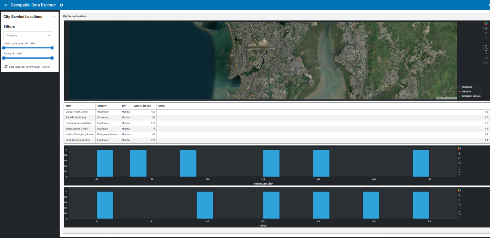

# :material-map-marker-multiple: Building a Geospatial Data Explorer

Build an interactive geospatial dashboard with Lumen using a CSV dataset. This tutorial introduces data sources, pipelines, map visualizations, linked selections, and histograms.



**Estimated time:** 15-20 minutes

## What you'll build

By the end of this tutorial, you'll have a dashboard that:

- Displays service locations on an interactive map.
- Filters locations by category, visitor count, and rating.
- Shows the selected locations in a table.
- Compares visitor counts and ratings with histograms.

The included dataset contains fictional example locations and illustrative values. It does not represent verified real-world facilities or statistics.

## Prerequisites

- Python and Lumen installed. See the [installation guide](../../installation.md).
- Basic familiarity with YAML.

## Step 1: Load the geographic data

The example dataset is stored in `examples/gallery/geospatial_data_explorer/city_service_locations.csv`. It contains names, categories, cities, longitude and latitude coordinates, visitor counts, and ratings.

Lumen can load the CSV through a file source. Open `examples/gallery/geospatial_data_explorer/geospatial_data_explorer.yaml` and locate its `sources` section:

```yaml
sources:
  service_locations:
    type: file
    cache_per_query: false
    tables:
      locations: ["./city_service_locations.csv", "csv"]
```

The source is named `service_locations`, and its `locations` table refers to the CSV file. Keeping the YAML and CSV in the same directory lets the relative path resolve correctly when running the example from its intended location.

## Step 2: Create a pipeline

A pipeline describes how data is prepared before it reaches a visualization. Add the following `locations` pipeline under the top-level `pipelines` key:

```yaml
pipelines:
  locations:
    source: service_locations
    table: locations
    filters:
      - type: widget
        field: category
      - type: widget
        field: visitors_per_day
      - type: widget
        field: rating
    transforms:
      - type: columns
        columns:
          - name
          - category
          - city
          - longitude
          - latitude
          - visitors_per_day
          - rating
      - type: project_lnglat
        longitude: longitude
        latitude: latitude
```

The widget filters let users interactively narrow the data. The columns transform selects the fields used by the dashboard, while `project_lnglat` prepares the longitude and latitude coordinates for geographic visualization.

## Step 3: Plot locations on a map

Under the existing top-level `layouts` key, add a layout containing a map view:

```yaml
layouts:
  - title: City Service Locations
    views:
      service_map:
        type: hvplot
        pipeline: locations
        kind: points
        x: longitude
        y: latitude
        c: category
        tiles: ESRI
        responsive: true
        height: 500
        xaxis: null
        yaxis: null
        selection_group: service_locations
        streaming: true
```

Here, `kind: points` plots individual locations. The `x` and `y` fields specify longitude and latitude, and `c: category` distinguishes categories visually. The map tiles provide geographic context.

## Step 4: Connect map selections to a table

You can connect views through a shared selection group. First, add a `selected` pipeline under the existing `pipelines` section:

```yaml
  selected:
    pipeline: locations
    filters:
      - type: param
        parameter: service_map.selection_expr
```

This pipeline filters the location data using the map's selection expression.

Next, add this view inside the existing `views` mapping:

```yaml
      service_table:
        type: table
        pipeline: selected
        hidden_columns:
          - longitude
          - latitude
        page_size: 10
        sizing_mode: stretch_width
        show_index: false
        theme: midnight
```

Selecting points on the map now filters the table to the corresponding locations. The coordinate columns are hidden because the map already communicates their geographic position.

## Step 5: Add histograms

Histograms help you explore the distribution of numeric fields. Add these two views to the existing `views` mapping:

```yaml
      visitors_hist:
        type: hvplot
        pipeline: locations
        kind: hist
        y: visitors_per_day
        responsive: true
        height: 250
        selection_group: service_locations
        streaming: true

      rating_hist:
        type: hvplot
        pipeline: locations
        kind: hist
        y: rating
        responsive: true
        height: 250
        selection_group: service_locations
        streaming: true
```

Both charts use the same selection group as the map, allowing the dashboard's linked views to work together. The first histogram explores daily visitor counts; the second explores ratings.

## Step 6: Run the dashboard

From the Lumen repository root, run:

```bash
lumen serve examples/gallery/geospatial_data_explorer/geospatial_data_explorer.yaml --show
```

Explore the map, change the filters, select locations, and compare the resulting table and histograms.

## What you learned

In this tutorial, you learned how to:

- Load geographic data from a CSV file.
- Prepare data with pipelines, filters, and transforms.
- Plot longitude and latitude on a map.
- Link map selections to a table and other views.
- Explore numeric fields with histograms.

## Next steps

Try replacing the illustrative CSV with your own dataset containing longitude and latitude columns. You could also add more categories, numeric fields, or visualizations to explore a different geographic use case.


