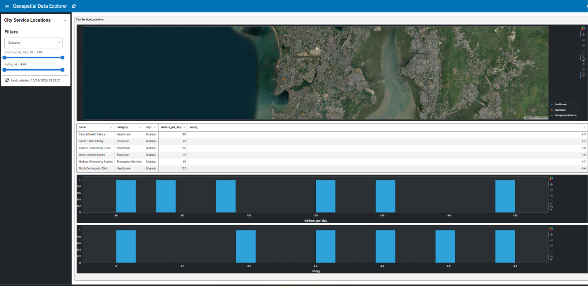

# :material-map-marker-multiple: Geospatial Data Explorer

Explore real New York City 311 service requests with an interactive dashboard built using Lumen's YAML configuration. This example combines geographic visualization, interactive filtering, linked selections, and a histogram of request resolution times.



## What you will learn

- Load a local CSV dataset into a Lumen file source.
- Visualize geographic points using longitude and latitude.
- Add interactive filters for borough, complaint type, and resolution time.
- Link map selections to a table so you can inspect individual service requests.
- Use a histogram to explore the distribution of request resolution times.
- Derive a useful measure, resolution time in hours, from request timestamps.

## What makes this example different?

Rather than using illustrative location data, this example explores real NYC 311 service requests. It demonstrates how geographic exploration can be combined with operational data analysis: filter requests by borough and complaint type, select locations on the map to inspect individual records, and analyze a derived resolution-time metric with a histogram.

The example therefore covers both spatial patterns and service-resolution behavior in one linked dashboard.

## Dataset

This example uses a snapshot of NYC 311 service requests from [NYC Open Data](https://data.cityofnewyork.us/Social-Services/311-Service-Requests-from-2020-to-Present/erm2-nwe9).

The CSV file is located at `examples/gallery/geospatial_data_explorer/nyc_311_requests.csv`. It contains request identifiers, creation and closure dates, complaint types, boroughs, statuses, longitude and latitude coordinates, and resolution times in hours.

The dataset is a local snapshot, so the dashboard does not need to query the NYC Open Data API every time it runs. Resolution time is calculated from the creation and closure timestamps for requests with usable timestamps.

## Run the example

From the Lumen repository root, install the project dependencies if you have not already done so, then run:

```bash
lumen serve examples/gallery/geospatial_data_explorer/geospatial_data_explorer.yaml --show
```

Lumen starts a local server and opens the dashboard in your browser. If the browser does not open automatically, visit `http://localhost:5006/geospatial_data_explorer`.

Keep the CSV file in the same directory as the YAML configuration because the data source uses a relative path.

## How it works

The dashboard configuration is defined in `examples/gallery/geospatial_data_explorer/geospatial_data_explorer.yaml`.

### 1. Load the CSV

The `service_requests` file source loads the local CSV, making its records available to the dashboard pipeline.

```yaml
sources:
  service_requests:
    type: file
    tables:
      requests: ["./nyc_311_requests.csv", "csv"]
```

The path is relative to the directory containing the YAML configuration.

### 2. Filter and transform the data

The `requests` pipeline adds interactive filters for `borough`, `complaint_type`, and `resolution_hours`. It also selects the fields displayed in the dashboard and uses the `project_lnglat` transform to prepare longitude and latitude for geographic plotting.

This lets you explore requests from particular boroughs or complaint categories without modifying the original CSV.

### 3. Explore requests on the map

The map uses the longitude and latitude columns to position service requests geographically. Points are colored by borough, and the map uses OpenStreetMap tiles for geographic context.

Select points on the map to investigate the corresponding records in the linked table.

### 4. Inspect linked records in the table

The table displays the selected requests and their details, including complaint type, borough, status, and resolution time. Longitude and latitude are hidden in the table because they are already represented visually on the map.

This linked selection makes it easier to move from a geographic pattern to the underlying records.

### 5. Analyze resolution times

The histogram shows the distribution of `resolution_hours`. Use it to investigate whether resolution times tend to be short or long and how the distribution changes when you filter the data.

Resolution time is a derived measure rather than a raw complaint field, allowing the dashboard to explore service outcomes as well as locations.

## Things to explore

- Filter by borough to compare the geographic distribution of service requests.
- Choose a complaint type to see where that category occurs.
- Select map points and inspect the corresponding records in the table.
- Examine the resolution-time histogram and observe how filtering changes the distribution.
- Compare geographic concentrations with the resolution times of the filtered requests.

## Further reading

- [Lumen documentation](https://lumen.holoviz.org/)
- [NYC 311 Service Requests dataset](https://data.cityofnewyork.us/Social-Services/311-Service-Requests-from-2020-to-Present/erm2-nwe9)
